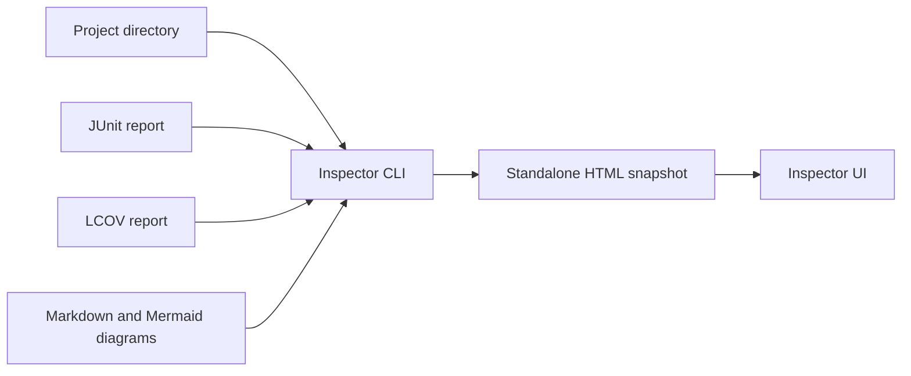

# Inspector architecture

## Report generation

- [CLI](../src/inspector/cli.ts) collects JUnit/LCOV evidence, local source and diagram definitions into one JSON snapshot. The HTML embeds that snapshot and Vite's script/CSS; it never runs project tests.
- [Diagram discovery](../src/inspector/diagrams/infra/discover.ts) enumerates project-local documents using Git (or filesystem traversal outside Git), excluding generated paths and symlinks. Read failures other than locally deleted files fail generation rather than silently omitting evidence.
- [Markdown parsing](../src/inspector/diagrams/domain/parse.ts) uses a CommonMark syntax tree to identify Mermaid fences, heading titles and line numbers. Each block remains separate; invalid Mermaid is retained for a local rendering error. Markdown and diagram source are data, not executable HTML.
- [Inspector UI](../src/inspector/ui/index.ts) retains navigation state. Pure [diagram markup](../src/inspector/diagrams/ui/components/html.ts) receives snapshot values; the [container](../src/inspector/diagrams/ui/container.ts) owns Mermaid rendering, resize observers and dialog lifetime.
- Diagrams render sequentially in strict mode when their view opens. Leaving the view disconnects observers and ignores pending rendering results. Errors replace only the affected card; raw parser errors/source are not displayed.
- The native modal moves the existing SVG into its presentation stage to preserve unique SVG IDs. Closing restores the SVG and keyboard focus. [Fit calculation](../src/inspector/diagrams/domain/fit.ts) preserves aspect ratio within available width/height; zoom is relative to that fit. Resizing recomputes it.
- Vite inlines Mermaid's lazy renderer imports into the single offline bundle. Mermaid 11 preserves the package's Node 20 support; no remote renderer or custom icon/font service is configured.

## Verification

- `npm test`: build, existing regression suite, diagram parsing/discovery, snapshot safety, fit calculations and markup contracts.
- `npm run test:browser`: build and driven Playwright tests against real generated `file:` reports in installed Google Chrome, offline. Chrome is a developer prerequisite; no browser is needed to generate a report.
- Browser scenarios cover flowchart, sequence, architecture, state and mindmap rendering; errors, empty state, unchanged views, compact previews, dialog sizing, fit on resize, zoom/reset, closing, focus restoration, navigation during rendering and unsafe markup.
- Pi pipeline suite `test` runs the main checks. Run `npm run test:browser` separately for browser coverage; adding it as a pipeline suite requires configuration approval. Browser tests make DOM/geometry assertions, not screenshots or visual-approval claims.
- Approved design reference: [mockup revision 10](../mockups/inspector-diagrams/DESIGN.md). Visual comparison with the implemented report remains a separate user review.
